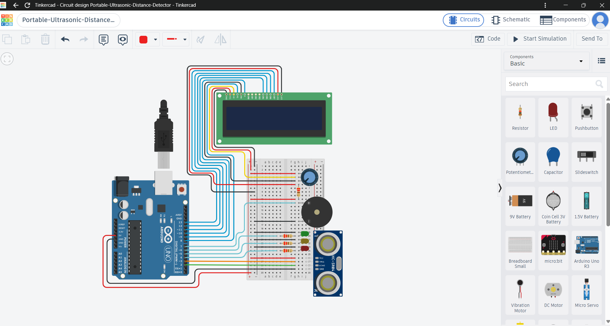

# Portable Ultrasonic Distance Detector

An ultrasonic-based distance detector with LCD readings and LED/buzzer alerts.

## Technologies

- Arduino

- HC-SR04 Ultrasonic Sensor

- 16×2 LCD

- LED

- Buzzer

- C++

- Tinkercad

## Key Features

- Measures distance using an ultrasonic sensor

- Displays distance on a 16×2 LCD

- Provides LED and buzzer alerts based on distance

## Circuit

## Tinkercad Simulation

[View and simulate the project on Tinkercad](https://www.tinkercad.com/things/9yPHxHI4k5n-portable-ultrasonic-distance-detector)

